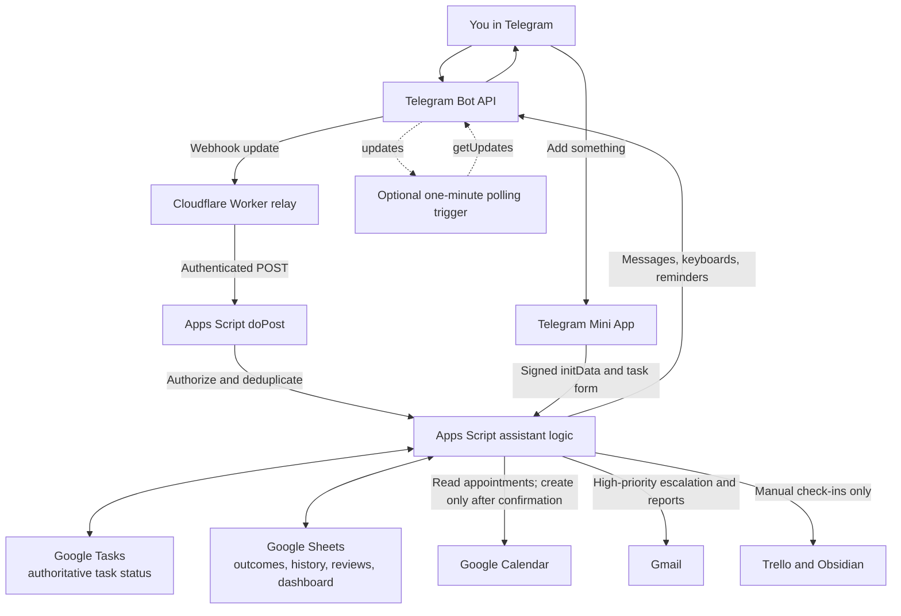
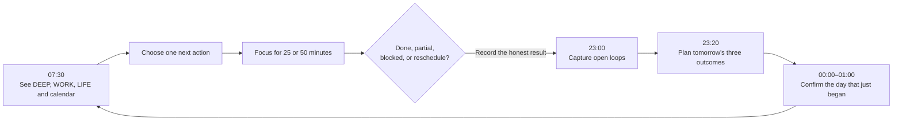

# Personal Productivity Assistant

A personal productivity and accountability assistant using Google Apps Script, Sheets, Tasks, Calendar, Telegram, and Gmail. Trello and Obsidian are manual check-ins; their APIs are not used.

## System flow

Telegram webhook delivery passes through a small Worker that follows Apps Script's Content Service redirect, then returns a normal success response after Apps Script reports the update processed. This avoids Telegram rejecting Apps Script's redirected response. The Worker does not contain task or productivity logic; Apps Script remains the automation engine. Cloudflare's [Free plan currently lists](https://developers.cloudflare.com/workers/platform/pricing/) 100,000 Worker requests per day and a 10 ms CPU limit per invocation; check current limits and terms before use.

Google Tasks is authoritative for task status. Sheets keeps synchronized records, logs, reviews, and history. A Telegram delivery is never completion. Calendar events are created only after you confirm a Telegram preview.

### The daily loop

The full task list remains available with `/tasks`, but the home screen centers on three outcomes: **DEEP** (growth), **WORK** (work/SDR), and **LIFE** (health or administration). Add a next action through **Add something**; the Mini App offers a date picker, area, priority, optional time block, a “done” test, and a Top 3 toggle. Calendar blocks are previews and are not created until confirmed in Telegram.

## First-time setup

Work through these steps in order. Do not paste secrets into source files, this README, Sheets, Telegram, or logs. Live services and deployment must be verified in your own accounts.

### 1. Prepare Apps Script and the database

1. Open the Apps Script project linked to `PERSONAL PRODUCTIVITY DATABASE`.
2. Add the project's `.gs` modules and `appsscript.json`.
3. In **Services**, enable **Google Tasks API** (Advanced Service v1). If prompted, enable the Google Tasks API in the linked Google Cloud project.
4. Confirm the existing Script Properties are present. Do not change their values:
   - `AUTHORIZED_TELEGRAM_USER_ID`
   - `GOOGLE_TASK_LIST_ID`
   - `SPREADSHEET_ID`
   - `TELEGRAM_BOT_TOKEN`
   - `TELEGRAM_CHAT_ID`
   - `WEBHOOK_SECRET`
   - `WEB_APP_URL`
5. Run `setupDatabase()` and approve the requested permissions. Confirm the Dashboard and all data tabs exist: Tasks, Daily_Outcomes, Review_Notes, MiniApp_Requests, Telegram_Messages, Telegram_Actions, Reminder_History, Task_History, Accountability_Routines, Accountability_Checkins, Daily_Reviews, Weekly_Reviews, Monthly_Reviews, Email_Escalations, System_Logs, Settings, and Sync_Logs.
6. Run `syncGoogleTasks()` and verify Tasks, Task_History, and Sync_Logs.

Setup preserves existing records and stops if a sheet header is unexpected.

### 2. Deploy the Apps Script web app

1. In Apps Script, choose **Deploy → New deployment → Web app**.
2. Set **Execute as** to your account and **Who has access** to **Anyone**. The Worker authenticates forwarded updates using the existing `WEBHOOK_SECRET`; only enter the deployment URL and secret in the Worker settings as described below, and do not post them publicly or in chat.
3. Deploy, copy the `/exec` URL, and set it as the value of the existing `WEB_APP_URL` Script Property. If updating existing code, choose **Deploy → Manage deployments → Edit**, select **New version**, and deploy the update.
4. Run `configureTelegramCommands()` once to publish the short command menu in Telegram. The Mini App button uses the existing `WEB_APP_URL`; if you created a new deployment, update that property to the new `/exec` URL first.

Do not run `doPost()` from the editor; manual execution does not provide a real Telegram request.

### 3. Create the Cloudflare Worker relay

1. Sign in to Cloudflare and create a Worker using the module source in `telegram-webhook-worker.js`.
2. In the Worker settings, add the following variables/secrets:
   - `APPS_SCRIPT_WEB_APP_URL` — the `/exec` URL from `WEB_APP_URL` (regular variable).
   - `APPS_SCRIPT_WEBHOOK_SECRET` — a copy of the existing `WEBHOOK_SECRET` (secret).
   - `TELEGRAM_WEBHOOK_SECRET` — a new random value of 1–256 letters, numbers, underscores, or hyphens (secret).
3. Deploy the Worker and copy its HTTPS URL.

The Worker forwards only valid Telegram update payloads to the configured Apps Script URL. It never logs request bodies or secrets. The existing Apps Script webhook secret is copied to Cloudflare for relay authentication; it remains in Apps Script Properties too.

### 4. Connect Telegram to the relay

1. In Apps Script **Project Settings → Script Properties**, add:
   - `TELEGRAM_WEBHOOK_RELAY_URL` — the Worker HTTPS URL.
   - `TELEGRAM_WEBHOOK_SECRET` — the exact same new random secret configured in the Worker.
2. Run `setTelegramWebhook()`. This registers the Worker URL with Telegram and removes the polling trigger. It does not discard queued Telegram updates.
3. Run `getTelegramWebhookInfo()` and confirm the result shows `matchesConfiguredRelay: true`, both `message` and `callback_query` are allowed, and `last_error_message` is empty.
4. Send `/start` and `/help`, then click a harmless button. Confirm updates and results appear in Telegram_Messages and Telegram_Actions, and inspect Apps Script **Executions**.

If you prefer Apps Script-only delivery, run `enableTelegramPolling()` instead. This disables the webhook, discards pending Telegram updates, and enables one-minute polling; replies may be delayed. Do not use webhook mode and polling at the same time.

### 5. Test, then install scheduled jobs

1. Test `/start`, `/help`, `/today`, `/tasks`, and `/weekly`. Confirm the home and control-panel buttons edit their original message.
2. Open **Add something** from Telegram, submit a disposable task, and confirm one matching task and request record appear in Google Tasks and MiniApp_Requests. Test the Top 3 toggle.
3. If testing a Calendar block, submit a disposable task with a proposed block and verify that no event appears until you tap **Confirm Calendar block**.
4. Test focus status buttons and a routine confirmation. Verify immediate callback acknowledgement, one Telegram_Actions record per tap, and exact timestamps/task counts in Accountability_Checkins.
5. Use disposable tasks to test completion, postponement, rescheduling, blocker capture, and cancellation. Cancellation requires a second explicit confirmation.
6. Run `testEmailEscalation()` only when ready to receive a labeled test email. It does not create an escalation or change task status.
7. Run `runSystemHealthCheck()` and resolve any reported errors.
8. Run `installTriggers()`. In Apps Script **Triggers**, verify the delivery trigger matches the selected mode (`runTelegramPollingCycle` only for polling), along with the reminder, sync, review, report, and health jobs.

Do not test task completion or cancellation on real commitments.

## Normal use

### Start from the home screen

Send `/start` or tap **Start DEEP**, **Start WORK**, or **Start LIFE**. When prompted, name the smallest visible result you can finish in 25–50 minutes, then choose a focus block. At the end, record **Done**, **Partly done**, **Blocked**, or **Reschedule**. Only an explicit **Done** confirmation can complete the linked Google Task.

Use **Add something** to open the form instead of typing a task format. If the Mini App is unavailable, `/addtask` starts a short guided capture with a due-date choice and a done test. Send an uncategorized message to Telegram to choose whether it is a next action, project, or idea:

- **Next action:** Google Tasks.
- **Project:** add or update it manually in Trello; the bot does not use Trello APIs.
- **Idea:** add it manually to your Obsidian Inbox or Someday list; the bot does not use Obsidian APIs.

### Commands

- `/today` — daily outcomes, calendar, and home actions.
- `/tomorrow` — view tomorrow’s tasks and appointments; confirmation is reserved for the midnight checkpoint.
- `/tasks` and `/overdue` — full pending task list and overdue actions.
- `/focus` — start a focused block for an outcome.
- `/capture` — choose next action, project, or idea.
- `/review` — open the daily planning prompt; `/weekly` and `/monthly` — guided reviews.
- `/habits` — manual Trello and Obsidian check-ins.
- `/progress`, `/completed`, `/accountability` — progress and status.
- `/calendar` and `/postpone` remain available as advanced shortcuts; Calendar changes require explicit confirmation.
- `/help` — action control panel. Telegram also shows the configured command menu.

### Daily schedule

- **07:30:** morning home screen with DEEP/WORK/LIFE outcomes and calendar.
- **14:15:** SDR target, hypothesis, and learning question.
- **22:30:** evening progress review and confirmed accountability check-ins.
- **23:00:** shutdown and open-loop capture.
- **23:20:** five-line planning conversation: DONE today, DEEP, WORK, LIFE, and RISK.
- **00:00–01:00:** mandatory planning confirmation for the day that has just begun. If unanswered, the routine is recorded as missed.

The exact routine times and reminder settings are stored in Settings; all scheduling uses `Africa/Cairo`.

Routine times, reminder limits, and scoring weights are managed in Settings. Timezone: `Africa/Cairo`.

## Project modules

- **Configuration and helpers:** `Config.gs`, `Utilities.gs`, `Logger.gs`
- **Database and dashboard:** `Database.gs`, `DatabaseSetup.gs`
- **Google services:** `GoogleTasks.gs`, `Calendar.gs`
- **Conversation and capture:** `Conversation.gs`, `DailyOutcomes.gs`, `TaskMiniApp.gs`, `TaskMiniAppLayout.html`
- **Telegram:** `Telegram.gs`, `TelegramWebhook.gs`; optional relay: `telegram-webhook-worker.js`
- **Accountability and reminders:** `Accountability.gs`, `Reminders.gs`
- **Reports, email, operations:** `Reports.gs`, `EmailEscalation.gs`, `Setup.gs`
- **Runtime settings:** `appsscript.json`

## Safety and troubleshooting

- Google Tasks is authoritative. History is retained in Sheets; tasks are never auto-completed or auto-cancelled.
- Calendar sync reads appointments only. Creating events requires an explicit confirmation.
- Trello and Obsidian are manual prompts; no API integration is used.
- Secrets stay in Apps Script Properties and Cloudflare Worker Secrets, never in source, Sheets, Telegram messages, or logs.
- Callback handling is deduplicated. Reminder cycles avoid replaying stale reminders after downtime.
- For **no Telegram response in webhook mode**, run `getTelegramWebhookInfo()`. Confirm the relay URL matches, check Cloudflare Worker **Logs** for request/status errors (never log secrets or payloads), and inspect Apps Script **Executions** and System_Logs.
- For **Telegram `302 Found`**, verify Telegram's webhook points to the Worker URL, not directly to the Apps Script `/exec` URL. The Worker treats Apps Script's Content Service redirect as the expected response.
- For **no Telegram response in polling mode**, run `runTelegramPollingDiagnostics()` and check that the webhook is disabled and the polling trigger exists. Expect trigger-based delays.
- For **missing tabs or headers**, run `setupDatabase()` again; resolve any unexpected-header error first.
- For **Google Tasks errors**, verify the Advanced Service and Cloud API are enabled and the configured task list is accessible.
- For **email errors**, authorize email access and inspect the effective-user email, sending quota, Email_Escalations, Sync_Logs, and System_Logs.
- For **scheduled jobs**, inspect Apps Script **Triggers** and **Executions**, run `runSystemHealthCheck()`, and reinstall using `installTriggers()` if appropriate. Use `removeTriggers()` to remove only managed triggers.
- Functions ending in `_` are private helpers. Public setup/operations include `setupDatabase`, `syncGoogleTasks`, `setTelegramWebhook`, `getTelegramWebhookInfo`, `enableTelegramPolling`, `runTelegramPollingDiagnostics`, `installTriggers`, `removeTriggers`, and `runSystemHealthCheck`.

This repository does not verify live Google, Telegram, Cloudflare, Gmail, spreadsheet, or trigger behavior. Complete the checklist in your accounts before relying on automation.
