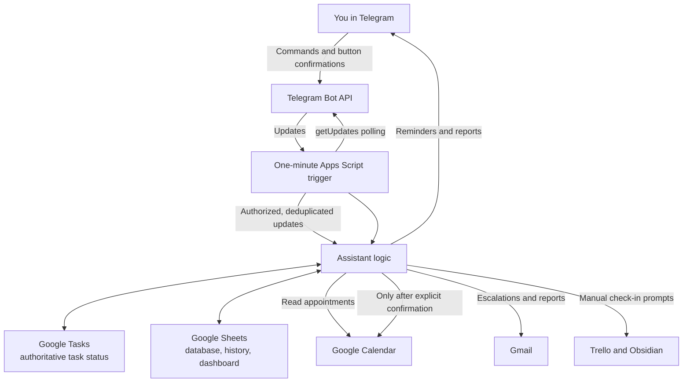

# Personal Productivity Assistant

A personal productivity and accountability assistant built with Google Apps Script, Google Sheets, Google Tasks, Google Calendar, Telegram, and Gmail. Trello and Obsidian check-ins are manual reminders; this project does not use either service's API.

## How it works

Google Tasks determines task status. Sheets keeps synchronized records, logs, reviews, and history. Telegram delivery alone is never treated as task completion. Calendar events are created only after you confirm a Telegram preview.

## First-time setup

Complete these steps in order. The project does not automatically deploy itself or perform live integration checks.

### 1. Prepare Apps Script

1. Open the Apps Script project linked to the productivity database spreadsheet.
2. Add the `.gs` modules listed below and replace the project manifest with `appsscript.json`.
3. In **Services**, enable **Google Tasks API** (Advanced Service v1). Enable the associated Google Tasks API in the linked Google Cloud project if prompted.
4. Confirm the existing Script Properties are present. Do not copy their values into source code, Sheets, or this README:
   - `AUTHORIZED_TELEGRAM_USER_ID`
   - `GOOGLE_TASK_LIST_ID`
   - `SPREADSHEET_ID`
   - `TELEGRAM_BOT_TOKEN`
   - `TELEGRAM_CHAT_ID`

   Telegram polling uses the bot token, chat ID, and authorized user ID. The existing `WEBHOOK_SECRET` and `WEB_APP_URL` properties are not used in polling mode; leave them untouched.

### 2. Create and verify the database

1. From the Apps Script editor, run `setupDatabase()` and approve the requested permissions.
2. Open the spreadsheet and confirm the 15 required tabs exist: Dashboard, Tasks, Telegram_Messages, Telegram_Actions, Reminder_History, Task_History, Accountability_Routines, Accountability_Checkins, Daily_Reviews, Weekly_Reviews, Monthly_Reviews, Email_Escalations, System_Logs, Settings, and Sync_Logs.
3. Check that the Dashboard and its formulas/charts are present.
4. Run `syncGoogleTasks()` and verify the Tasks and Task_History tabs, plus Sync_Logs.

Setup preserves existing records and refuses to overwrite an unexpected header. Resolve any header error before continuing.

### 3. Switch Telegram to Apps Script polling

1. In the Apps Script editor, run `enableTelegramPolling()`. This removes the webhook, clears Telegram's pending update queue, and installs a one-minute polling trigger. Clearing the queue prevents old button actions accumulated during webhook failures from running unexpectedly.
2. Run `runTelegramPollingDiagnostics()` and open its execution log. Confirm `webhookDisabled` and `pollingTriggerInstalled` are `true`, and `pendingUpdateCount` is `0`.
3. Send `/start` to the bot. Polling is trigger-driven, so delivery is not immediate; allow a minute or two, then check Telegram_Messages and Apps Script **Executions**.

Do not run `setTelegramWebhook()` or manually run `doPost()`. Telegram polling does not require a Web App deployment. Inline-button actions can also be delayed until the next polling run, and Telegram's temporary click indicator may expire before the bot replies; the action result is sent as a normal chat message.

Polling is used because Apps Script's [Content service redirects responses](https://developers.google.com/apps-script/guides/content#redirects), and Telegram reported `302 Found` for the webhook. The polling trigger calls Telegram's `getUpdates` API directly instead.

### 4. Test manually before enabling all scheduled automation

1. After polling is enabled, send `/start`, `/help`, `/today`, `/tasks`, and `/review` from the authorized Telegram account.
2. Check incoming/outgoing messages in Telegram_Messages and callback results in Telegram_Actions.
3. Confirm a routine button once, then verify its exact confirmation timestamp in Accountability_Checkins. Check replay protection by repeating a callback.
4. Use a disposable task to test creation, completion, postponement, and cancellation. Cancellation requires a second explicit confirmation.
5. To test Calendar creation, send `/calendar TASK-ID | YYYY-MM-DD HH:mm | YYYY-MM-DD HH:mm`. Inspect the preview and confirm it only when correct.
6. Run `testEmailEscalation()` when ready to receive a labeled test message at the script's effective-user email. This does not create an escalation or change task status.
7. Run `runSystemHealthCheck()` and inspect the returned statuses and System_Logs.

Do not test task deletion or completion with real commitments.

### 5. Turn on scheduled automation

1. Run `installTriggers()`.
2. In Apps Script, open **Triggers** and verify `runTelegramPollingCycle` and all other managed handlers appear.
3. Review **Executions** after the next scheduled runs. Run `runSystemHealthCheck()` again.
4. If needed, use `removeTriggers()` to remove only this project's managed triggers.

## Normal use

| What you want to do | Telegram command or action |
|---|---|
| See today's plan, appointments, and follow-ups | `/today` |
| See tomorrow's plan | `/tomorrow` |
| List pending tasks | `/tasks` |
| Review overdue work | `/overdue` |
| Create a task (requires confirmation) | `/addtask Task title \| High \| YYYY-MM-DD` |
| Schedule a pending task in Calendar (requires confirmation) | `/calendar TASK-ID \| YYYY-MM-DD HH:mm \| YYYY-MM-DD HH:mm` |
| Postpone or reschedule a task | `/postpone TASK-ID \| YYYY-MM-DD` |
| Confirm planning or review | `/review`, then choose a button |
| Complete a manual Trello or Obsidian check-in | `/habits`, then choose a button |
| Read progress or reports | `/progress`, `/weekly`, `/monthly` |
| See all supported commands | `/help` |

Routine times, reminder limits, and scoring weights are managed in the Settings tab. The timezone is `Africa/Cairo`.

## Project modules

- **Configuration and helpers:** `Config.gs`, `Utilities.gs`, `Logger.gs`
- **Database and dashboard:** `Database.gs`, `DatabaseSetup.gs`
- **Google services:** `GoogleTasks.gs`, `Calendar.gs`
- **Telegram interface and polling:** `Telegram.gs`
- **Accountability and reminders:** `Accountability.gs`, `Reminders.gs`
- **Reports, email, operations:** `Reports.gs`, `EmailEscalation.gs`, `Setup.gs`
- **Runtime settings:** `appsscript.json`

## Safety and operating notes

- Google Tasks is authoritative for task status. Sheets retains task references and append-only history.
- The assistant never automatically completes or cancels a task. A Telegram message or reminder is not proof of completion.
- No Calendar event is created by sync; event creation requires a user-confirmed preview.
- Trello and Obsidian prompts are manual check-ins; no API integration is used.
- Secrets are read from Apps Script Properties, not stored in Sheets or printed in Telegram.
- Callback handling is deduplicated. Reminder cycles avoid replaying stale reminders after downtime; expired follow-ups are not sent in a burst.
- Appointment reminders are sent by Telegram near the event start when the reminder cycle runs; missed appointment reminders are not replayed.
- The code in this workspace has not itself verified live Google, Telegram, Gmail, spreadsheet, or trigger behavior. Complete the setup and test steps in the Apps Script project before relying on automation.

## Troubleshooting

- **Missing tab or header:** run `setupDatabase()` again. It adds missing structure but will stop if an existing header does not match.
- **Google Tasks sync fails:** verify Google Tasks Advanced Service v1 and its Cloud API are enabled, and that the configured task list is accessible.
- **Telegram gets no updates:** run `runTelegramPollingDiagnostics()`. Confirm the webhook is disabled and the polling trigger is installed; then inspect Apps Script **Executions** for `runTelegramPollingCycle`.
- **No Telegram_Messages row after `/start`:** confirm `enableTelegramPolling()` completed, the one-minute `runTelegramPollingCycle` trigger exists, and the next execution succeeded. Do not run `doPost()` manually; polling does not use it.
- **A button action seems delayed:** polling runs on a time-driven trigger, so actions may take a minute or more. Check Telegram_Actions, then Apps Script **Executions** and System_Logs for errors. Telegram's click indicator may expire before the action result arrives in the chat.
- **Command is rejected:** use the Telegram account whose numeric user ID matches the existing `AUTHORIZED_TELEGRAM_USER_ID`.
- **Email is not delivered:** authorize email access, check the script's effective-user email and sending quota, then inspect Email_Escalations, Sync_Logs, and System_Logs.
- **Scheduled jobs do not run:** check Apps Script **Triggers** and **Executions**, run `runSystemHealthCheck()`, and reinstall with `installTriggers()` if appropriate.
- **A function is missing from the Run menu:** names ending in `_` are private helpers. Run the public entry points such as `setupDatabase`, `syncGoogleTasks`, `enableTelegramPolling`, `runTelegramPollingDiagnostics`, `installTriggers`, `removeTriggers`, and `runSystemHealthCheck`.
